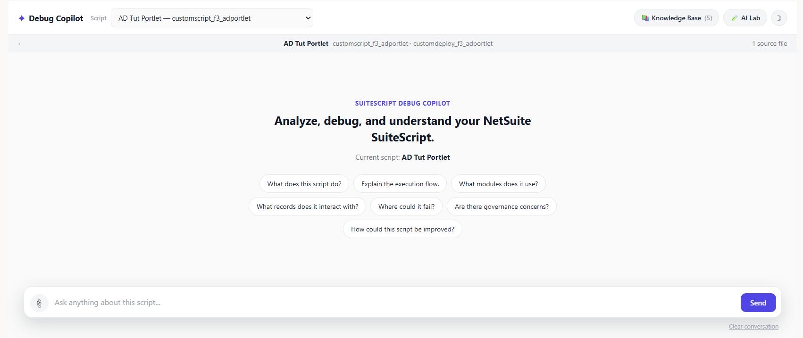
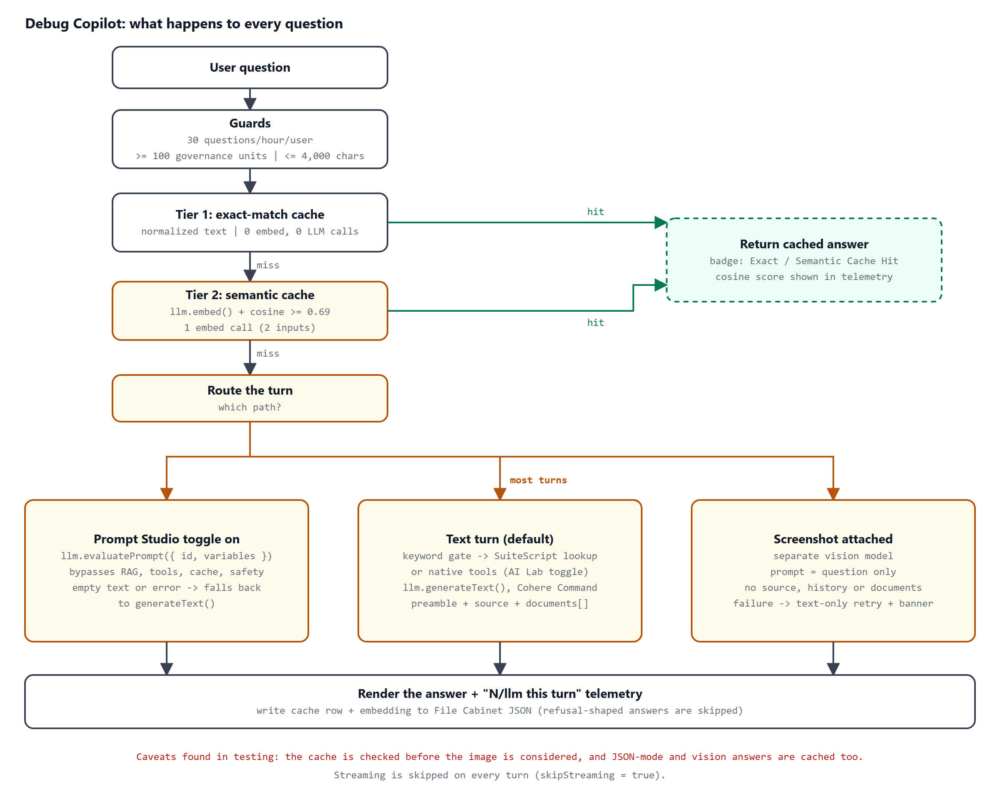
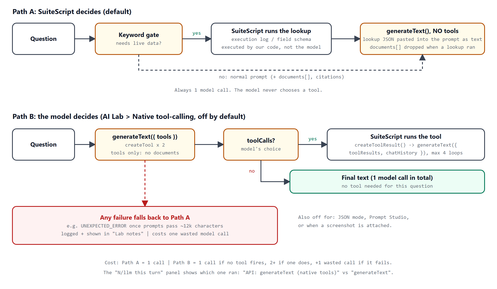

# NetSuite N/llm Debug Copilot

A single-Suitelet test bench for NetSuite's `N/llm` module. You pick a deployed script, ask questions about it, and get answers grounded in that script's real source, with a per-turn telemetry panel showing exactly which `N/llm` calls ran.

This is the companion repo for the Folio3 blog post **"NetSuite N/llm Under the Microscope: What Worked, What Broke, and What We Learned"**. Everything the post claims can be re-run from here.

> **Note:** behavior of `N/llm` varies by account, model availability, and platform version. Findings in the post are what we observed in one account. Re-verify them in yours.



## Features

- **Two-tier answer cache:** exact match (no embed call) and semantic match (`llm.embed()` + cosine similarity, threshold 0.69)
- **RAG:** Knowledge Base documents via `llm.createDocument()` with native `response.citations`; `.txt` / `.md` uploads
- **Two tool-calling paths:** a SuiteScript keyword path (default) and native `llm.createTool()` / `toolCalls` (opt-in, with automatic fallback)
- **Vision:** PNG / JPEG screenshots via a separate vision model, with a text-only retry
- **Prompt Studio:** `llm.evaluatePrompt()` against an editable prompt
- **Options:** `safetyMode`, JSON `responseFormat`, Cohere Command or GPT-OSS
- **Telemetry:** an "N/llm this turn" panel with API, model, tokens, similarity scores, documents, tools, citations, and fallback notes
- **Guards:** 30 questions per hour per user, governance floor, message and source size limits





## Prerequisites

- A NetSuite **sandbox** account with the **SuiteScript Generative AI APIs** feature enabled (Setup > Company > Enable Features > SuiteCloud)
- [SuiteCloud CLI](https://docs.oracle.com/en/cloud/saas/netsuite/ns-online-help/chapter_1558708800.html) authenticated to that account
- Node.js 18+ (only needed to run the tests)
- Administrator access (to create a role and set the deployment audience)

## Setup Guide

### Step 1: Clone the repository

```bash
git clone https://github.com/laibak24/netsuite-nllm-debug-copilot.git
cd netsuite-nllm-debug-copilot
```

### Step 2: Authenticate the SuiteCloud CLI

```bash
suitecloud account:setup
```

This creates a local `project.json`, which is git-ignored.

### Step 3: Deploy

```bash
suitecloud project:deploy
```

This deploys the Suitelet and client script, the knowledge documents, two custom records, the deployment, and the Prompt Studio prompt.

### Step 4: Create the role and set the audience by hand

SDF would not deploy the custom role or the deployment audience in our account, so these are manual.

1. Create a role named **Debug Copilot Pilot Tester** at Setup > Users/Roles > Manage Roles, with the permissions listed in [docs/customrole_debug_copilot_pilot.xml](docs/customrole_debug_copilot_pilot.xml).
2. Add the role to the `customrecord_debug_session` and `customrecord_dcs_document` permissions at Full.
3. Restrict the Suitelet deployment's **Audience** to that role.

There is no `N/llm` permission key. Access is gated by the account feature plus the deployment audience.

### Step 5: Prompt Studio (optional)

The deployment parameter `custscript_dcs_prompt_id` already points at `custprompt_debug_copilot_qa`. Edit that prompt in Prompt Studio to change behavior without a code deploy.

### Step 6: Open the Suitelet

Open the **SuiteScript Debug Copilot** Suitelet, pick a script from the dropdown, and ask a question. Open **AI Lab** to toggle features.

## Usage: the five checks from the blog

1. Ask "What does this script do?" and inspect the answer and citations.
2. Ask it again verbatim: exact cache hit, no embed and no LLM call.
3. Ask "What is the purpose of this script?": semantic cache hit, with the score in the telemetry panel.
4. Ask "What errors appeared in the latest execution log?" to trigger the live-data path. (Compare with "Why did this script fail?", which passes the keyword gate but fetches nothing. See Known issues.)
5. Turn on **JSON response** in AI Lab and ask a question that has not been cached.

## Run the tests

The tests load the real Suitelet source in Node with the NetSuite modules **mocked**. They prove how this code behaves, not how the live model answers.

```bash
npm test
```

Expected: `63 passed, 0 failed, 4 info`.

## Blog claim to test

| Claim in the post | Test |
|---|---|
| Default text path sends no `tools` to N/llm | T4b |
| "Tools offered" is shown although none were sent | T4e |
| Live-data turn drops `documents[]` | T4c |
| "Why did this script fail?" fetches no live data | T4x |
| Keyword `log` also matches "logic" | T2b, T2c |
| Unknown record type defaults to `salesorder` | T2d |
| Native tools: 2 calls when a tool fires, 1 when it does not | T5a, T5d |
| Native tools send no `documents`; loop capped at 4 | T5b, T5i |
| Failed native attempt costs an extra call and is visible in Lab notes | T5f, T5g |
| Native tools disabled with image or JSON mode | T5j, T5k |
| Exact cache: no embed, no LLM call | T6b |
| Semantic hit at 0.69 or higher; unrelated question misses | T6d, T6e |
| Refusal-shaped answers are not cached | T6g |
| JSON-mode answer is cached and leaks into a text request | T6h, T6i |
| Vision call: separate model, 800 tokens, no source or history | T7a, T7b |
| Vision turn reports a document count though none were sent | T7c |
| Same question plus a screenshot is served from cache | T7f |
| Vision failure retries text-only with a banner | T7g |
| Oversize image is truncated, not rejected | T11 |
| Prompt Studio bypasses generateText, cache and embed | T8a, T8b |
| Rate limit blocks the 31st question; 4,000-character cap | T9a, T9b |
| Embed failure is not caught in `handleAsk` | T9c |
| Streaming is never attempted (`skipStreaming = true`) | T4f |

## Known issues

These were found by testing and are open in this code:

- The keyword gate and the fetch patterns use different word lists, so some questions drop documents without fetching live data.
- Substring matching: "logic", "catalog", "truncate", "runtime" trigger live-data lookups.
- The cache context hash ignores JSON mode and images.
- Telemetry shows "Tools offered" and a document count on turns where they were not sent.
- Oversize screenshots are cut with `substring` instead of rejected.
- An `llm.embed()` failure surfaces as a page error.

## Project structure

```
src/
  FileCabinet/SuiteScripts/
    debug_copilot_suitelet.js       main Suitelet
    debug_copilot_client.js         client script
    debug-copilot/knowledge/*.txt   built-in Knowledge Base documents
  Objects/                          Suitelet + deployment, custom records, Prompt Studio prompt
  deploy.xml, manifest.xml
docs/
  customrole_debug_copilot_pilot.xml   role spec (create by hand)
  diagrams/, images/
tests/
  harness.js, tests.js              Node tests on mocked N/llm
```

## Troubleshooting

- **`llm` is undefined or calls fail immediately:** the SuiteScript Generative AI APIs feature is not enabled.
- **Cache write fails with a permissions error:** the role needs File Cabinet edit access (`LIST_FILECABINET`), because embeddings are written as JSON files under the caller's role.
- **"The customrole object is invalid" during deploy:** expected. Create the role by hand (Step 4).
- **Every answer says it cannot determine the answer:** turn **Contextual safety** off in AI Lab.
- **Prompt Studio toggle does nothing:** check that `custscript_dcs_prompt_id` is set on the deployment.

## Security notes

- The Suitelet requires login (`isonline` is false). Keep it that way.
- Run it in a sandbox. It reads execution logs and record metadata.
- Generated text is HTML-escaped before Markdown formatting.

## License

MIT. See [LICENSE](LICENSE).

## Acknowledgments

Built at [Folio3 NetSuite Services](https://netsuite.folio3.com). Related reading: [Prompt Studio: From SuiteQL Rows to a Business Summary](https://netsuite.folio3.com/blog/prompt-studio-from-suiteql-rows-to-a-business-summary/) and [Building Custom Tools for NetSuite AI Connector](https://netsuite.folio3.com/blog/building-custom-tools-for-netsuite-ai-connector-development-guide/).
